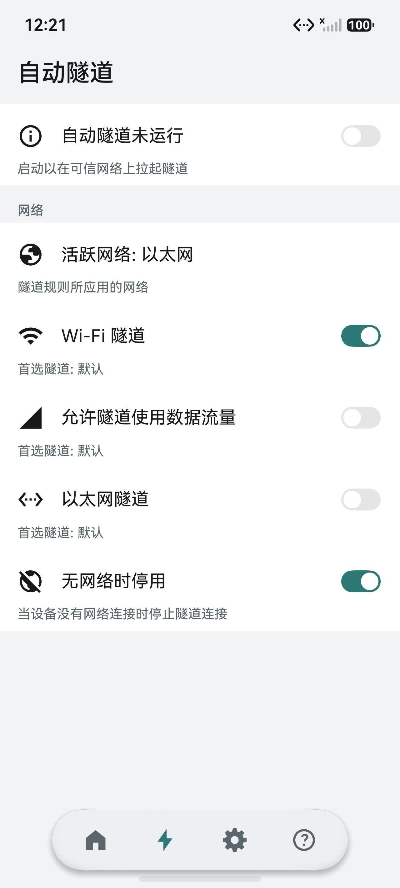

# WGate

WGate 是一个 **HarmonyOS（鸿蒙）上的 WireGuard 客户端**。它把你的网络流量加密后送到自己的服务器，在公共 Wi-Fi 上也能像在家里一样上网。

界面和交互移植自 Android 上的开源应用 [WG Tunnel](https://github.com/Zaneschepke/wg-tunnel-compose)，隧道内核（WireGuard 协议本身）在鸿蒙上重写。

它不收费、没有账号、没有广告，也没有任何统计上报。你的配置和私钥只存在这台设备上。

---

## 能做什么

| 功能 | 说明 |
| --- | --- |
| 常用的连接管理 | 一键连上 / 断开，多个隧道随便建几个、改名、删除 |
| 一个隧道多个节点 | 一个配置里最多 8 个 peer，按 `AllowedIPs` 自动分流 |
| 到处都能导入 | 粘贴配置文本、选 `.conf` 文件、扫二维码，或者从别的 App 直接分享进来 |
| 也能导出 | 复制成 `wg-quick` 文本，或者生成二维码给另一台设备扫 |
| 自动隧道 | Wi-Fi、移动数据、以太网分别设置：连上哪个网就自动拉起哪个隧道 |
| 分应用代理 | 指定的 App 走隧道，其余走直连（或反过来） |
| 看得见的状态 | 实时收发流量、握手时间、在线节点数，还有内核事件日志 |
| 通知栏状态 | 通知里显示当前隧道和流量，切到后台也照样更新 |
| 桌面模式 | 鸿蒙 PC、二合一设备上有托盘图标，关窗口不停连接 |
| 看着舒服 | 深色 / 更深 / AMOLED / 浅色 / 跟随系统，中文和英文界面 |
| AmneziaWG | 支持 `H1–H4`、`Jc`、`S1`/`S2`、`S3` 等混淆参数，用来应对简单的协议识别 |

> 没有内置任何服务器，也不提供订阅。你得有自己的 WireGuard 服务端（或者别人给你一份配置）。

## 截图

| 手机上 | 电脑上（PC 模式） |
| --- | --- |
|  |  |

## 安装

目前**没有上架华为应用市场**，需要自己装。

**方式一：用 DevEco Studio 装到自己的设备上（推荐）**

1. 装 [DevEco Studio](https://developer.huawei.com/consumer/cn/deveco-studio/)（需要 6.0 及以上，自带 API 26 SDK）。
2. `File → Open` 打开本工程根目录。
3. 打开 `File → Project Structure → Signing Configs`，勾选 `Automatically generate signature`（要先登录华为开发者账号）。
4. 手机打开「开发者选项 → USB 调试」，插上线。
5. 点右上角的运行按钮。

**方式二：装现成的安装包**

```powershell
hdc install -r wgate.hap
```

前提是这个 `.hap` 已经用**你自己的**签名证书签过。仓库里不附带签名文件，未签名的包系统会直接拒绝安装。

## 第一次使用

1. 准备好一份 WireGuard 配置（`*.conf`，或者别人发给你的二维码）。
2. 打开 WGate，在「隧道」页点右上角的 `+`，导入配置。
3. 回到列表，点隧道打开连接。

连不上时，先看「隧道设置 → 配置 → 端点检查」：它会解析一次服务器地址并发一次握手，能分清是 DNS 的问题、网络的问题，还是密钥对不上。

## 常见问题

**为什么装不上？** 鸿蒙要求 VPN 类应用必须签名，未签名的包会被系统拒绝。用 DevEco Studio 的自动签名最省事。

**会不会上传我的配置？** 不会。没有服务端，没有账号，构建里也没有接广告、崩溃上报或统计 SDK。

**有 Android / iOS 版吗？** 没有，这是鸿蒙原生应用。Android 上请用上游的 WG Tunnel。

**为什么没有「开机自启」？** 鸿蒙不给第三方应用订阅开机广播的权限，这个开关只能骗人，所以没做。想开机就连，用「自动隧道」，连上网络就会自动拉起。

## 从源码构建

需要：DevEco Studio 6（含 API 26 SDK）、Node.js、SDK 自带的 CMake 与 Ninja。

```powershell
$env:DEVECO_SDK_HOME = "C:\Program Files\Huawei\DevEco Studio\sdk"
& "C:\Program Files\Huawei\DevEco Studio\tools\hvigor\bin\hvigorw.bat" assembleHap --no-daemon
```

产物在 `entry/build/default/outputs/default/entry-default-unsigned.hap`。

想装到设备上，还得在 DevEco Studio 里配好签名：`VpnExtensionAbility` 属于受限能力，必须用真实证书签。

自检脚本（不需要设备）：

```powershell
python tools\check_keepalive.py
```

它会逐条核对工程里的约束——图标有没有从脚本生成、tray 和启动图标是不是同一张、权限有没有超标、文案有没有漏翻。当前 132 项全过。

## 目录结构

```
AppScope/                    应用级配置和启动图标
entry/src/main/ets/          ArkTS 界面（pages / view / components / service / theme）
entry/src/main/cpp/          WireGuard 内核（C 实现，通过 NAPI 暴露给 ArkTS）
entry/src/main/resources/    图标、字符串、颜色
tools/                       生成脚本和自检（图标、翻译目录、测试台）
docs/                        工程说明和截图
```

## 关于图标

启动图标是脚本画的，不是拼来的图：一堵墙，中间开一道拱门，门槛上横着一条光。颜色沿用原项目的那块深色底板（`#21272A`）和主题里的青色（`#76BEBD`）。

`tools/icon_studio.py` 是画它的工具，`install <名字>` 一键换版本：

```powershell
python tools\icon_studio.py decide     # 画出候选，168 / 48 / 24 px 三档对照
python tools\icon_studio.py install t-door
python tools\make_tray_icons.py        # 顺手把状态栏 / 托盘图标切出来
```

## 许可

本项目以 **GPL-3.0** 发布，见 [LICENSE](LICENSE)。

界面、文案和交互流程移植自 WG Tunnel（MIT 许可）；WireGuard 内核部分源自 WireGuard 的参考实现（GPL-2.0）；其余第三方组件的版权与许可全文在 [THIRD-PARTY-NOTICES.md](THIRD-PARTY-NOTICES.md)。

「WireGuard」是 Jason A. Donenfeld 的注册商标，本项目只在描述兼容性时使用。

## 想看得更深

工程实现、平台限制、每个设计决定的来龙去脉，都写在 [docs/ENGINEERING.md](docs/ENGINEERING.md) 里。
