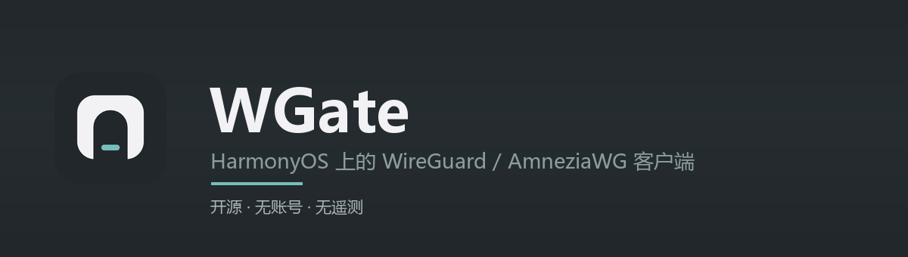
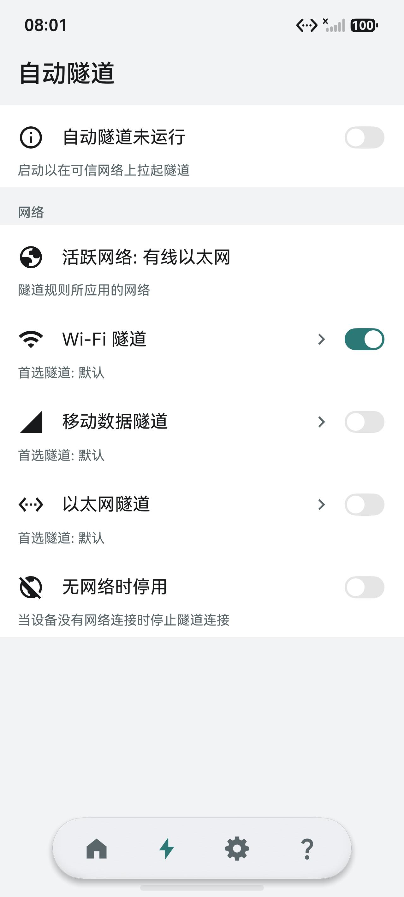
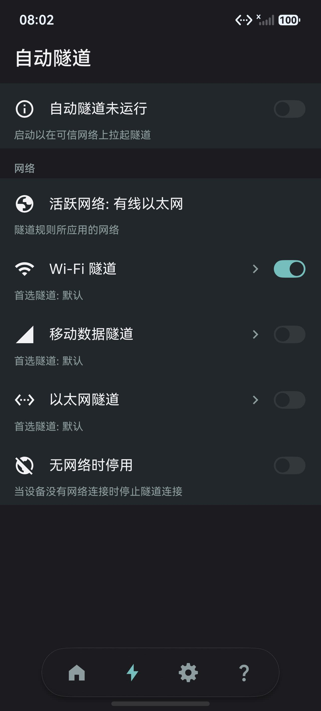
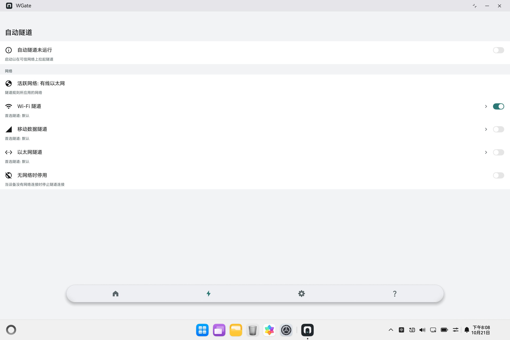

# WGate

**维门**（中文名，「W」+ Gate：一道通向你自己网络的门）。

WGate 是一个 **HarmonyOS（鸿蒙）上的 WireGuard 客户端**。它的用途很具体：**让你在任何地方连回自己的家庭网络或自己的服务器。**

出门在外——酒店、咖啡馆、机场、公司、国外出差——手机接的是别人的网络，但你要用的东西在家里：路由器后面的 NAS、打印机、摄像头、内网管理面板、家里那台小主机。把这些设备放进你自己的 WireGuard 服务端，手机连上 WGate 之后，它们就像还在同一个局域网里一样能打开。

流量从手机直连到你自己的服务器，全程加密，中途的 Wi-Fi 看不到内容，也不经过我们——**我们没有服务器可以经过。**

界面和交互移植自 Android 上的开源应用 [WG Tunnel](https://github.com/Zaneschepke/wg-tunnel-compose)，隧道内核（WireGuard 协议本身）在鸿蒙上重写。

它不收费、没有账号、没有广告，也没有任何统计上报。你的配置和私钥只存在这台设备上。

---

## 能做什么

| 功能 | 说明 |
| --- | --- |
| 常用的连接管理 | 一键连上 / 断开，多个隧道随便建几个、改名、删除 |
| 一个隧道多个对端 | 一个配置里最多 8 个 peer（对端），按 `AllowedIPs` 自动分流 |
| 导入或新建 | 从剪贴板粘贴、选一个 `.conf` / `.wg` 文件（或装着它们的 zip）、扫服务端生成的二维码；也能从零手动建一条 |
| 也能导出 | 复制成 `wg-quick` 文本，或者生成二维码给另一台设备扫 |
| 自动隧道 | Wi-Fi、移动数据、以太网分别设置：连上哪个网就自动拉起哪个隧道 |
| 看得见的状态 | 实时收发流量、握手时间、在线对端数，还有内核事件日志 |
| 通知栏状态 | 通知里显示当前隧道和流量，切到后台也照样更新；点一下通知直接回到应用 |
| 桌面模式 | 鸿蒙 PC、二合一设备上有托盘图标，关窗口不停连接 |
| 看着舒服 | 跟随系统 / 浅色 / 深色 / 更深 / AMOLED 五档配色，简体中文、繁體中文、English 三种界面 |
| AmneziaWG | 有些网络会干扰 WireGuard 流量，支持 `H1–H4`、`Jc`、`S1`/`S2`、`S3` 这些参数后，连接在这种网络里也能建立 |

> **WGate 不提供任何服务器、节点或订阅，也不内置任何第三方服务地址。** 你需要有一台自己的 WireGuard 服务端：家里路由器（OpenWrt、群晖、软路由）、家用的 NAS、或者自己租的服务器都可以。

## 截图

| 浅色 | 深色 |
| --- | --- |
|  |  |

**电脑上（PC 模式）**，同一套界面开在桌面窗口里；关掉窗口程序不退出，图标留在系统托盘：



> 图上是「自动隧道」页。带开关的行右侧如果还有一个 `›`，说明点这一行本身还能进下一页（Wi-Fi 规则、首选隧道）；只有开关的行就只切换状态。

## 安装

目前**没有上架华为应用市场**，需要自己装。

**方式一：用 DevEco Studio 装到自己的设备上（推荐）**

1. 装 [DevEco Studio](https://developer.huawei.com/consumer/cn/deveco-studio/)（需要 6.0 及以上，自带 API 26 SDK）。
2. `File → Open` 打开本工程根目录。
3. 打开 `File → Project Structure → Signing Configs`，勾选 `Automatically generate signature`（要先登录华为开发者账号）。
4. 手机打开「开发者选项 → USB 调试」，插上线。
5. 点右上角的运行按钮。

**方式二：装现成的安装包**

```powershell
hdc install -r wgate.hap
```

前提是这个 `.hap` 已经用**你自己的**签名证书签过。仓库里不附带签名文件，未签名的包系统会直接拒绝安装。

## 第一次使用

1. 在自己的服务端上准备一份 WireGuard 配置（`.conf`）——路由器、NAS 或服务器的管理界面通常都能导出一份，也能直接看到它的二维码。
2. 打开 WGate，在「隧道」页点右上角的 `+`：粘贴文本、选 `.conf` 文件、扫二维码，或者手动新建一条。
3. 回到列表，点隧道打开连接；再点进这一行可以看到它的配置、日志和开关。

连不上时，先看「隧道设置 → 配置 → 端点检查」：它会解析一次服务器地址并发一次握手，能分清是 DNS 的问题、网络的问题，还是密钥对不上。

## 常见问题

**为什么装不上？** 鸿蒙要求 VPN 类应用必须签名，未签名的包会被系统拒绝。用 DevEco Studio 的自动签名最省事。

**会不会上传我的配置？** 不会。我们这边没有服务端，没有账号，构建里也没有接广告、崩溃上报或统计 SDK。

**这和「加速器」「机场客户端」是一回事吗？** 不是。WGate 不内置任何节点、不提供订阅、没有服务器列表，它只连接你自己搭建的那一台 WireGuard 服务端。

**有 Android / iOS 版吗？** 没有，这是鸿蒙原生应用。Android 上请用上游的 WG Tunnel。

**为什么没有「开机自启」？** 鸿蒙不给第三方应用订阅开机广播的权限，这个开关只能骗人，所以没做。想开机就连，用「自动隧道」，连上网络就会自动拉起。

## 从源码构建

需要：DevEco Studio 6（含 API 26 SDK）、Node.js、SDK 自带的 CMake 与 Ninja。

```powershell
$env:DEVECO_SDK_HOME = "C:\Program Files\Huawei\DevEco Studio\sdk"
& "C:\Program Files\Huawei\DevEco Studio\tools\hvigor\bin\hvigorw.bat" assembleHap --no-daemon
```

产物在 `entry/build/default/outputs/default/entry-default-unsigned.hap`。

想装到设备上，还得在 DevEco Studio 里配好签名：`VpnExtensionAbility` 属于受限能力，必须用真实证书签。

自检脚本（不需要设备）：

```powershell
python tools\check_keepalive.py
```

它会逐条核对工程里的约束——图标有没有从脚本生成、tray 和启动图标是不是同一张、权限有没有超标、文案有没有漏翻。当前 147 项全过。

## 目录结构

```
AppScope/                    应用级配置和启动图标
entry/src/main/ets/          ArkTS 界面（pages / view / components / service / theme）
entry/src/main/cpp/          WireGuard 内核（C 实现，通过 NAPI 暴露给 ArkTS）
entry/src/main/resources/    图标、字符串、颜色
tools/                       生成脚本和自检（图标、翻译目录、测试台）
docs/                        工程说明和截图
```

## 关于图标

启动图标是脚本画的，不是拼来的图：一堵墙，中间开一道拱门，门槛上横着一条光。颜色沿用原项目的那块深色底板（`#21272A`）和主题里的青色（`#76BEBD`）。

`tools/icon_studio.py` 是画它的工具，`install <名字>` 一键换版本：

```powershell
python tools\icon_studio.py decide     # 画出候选，168 / 48 / 24 px 三档对照
python tools\icon_studio.py install t-door
python tools\make_tray_icons.py        # 顺手把状态栏 / 托盘图标切出来
```

## 许可

本项目以 **GPL-3.0** 发布，见 [LICENSE](LICENSE)。

界面、文案和交互流程移植自 WG Tunnel（MIT 许可）；WireGuard 内核部分源自 WireGuard 的参考实现（GPL-2.0）；其余第三方组件的版权与许可全文在 [THIRD-PARTY-NOTICES.md](THIRD-PARTY-NOTICES.md)。

「WireGuard」是 Jason A. Donenfeld 的注册商标，本项目只在描述兼容性时使用。

## 想看得更深

工程实现、平台限制、每个设计决定的来龙去脉，都写在 [docs/ENGINEERING.md](docs/ENGINEERING.md) 里。
